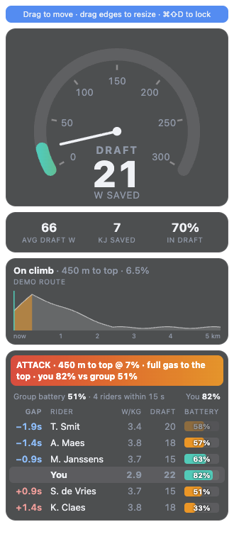

# Draftmeter

**See what Zwift doesn't show you:** how many watts you're saving in the draft, the gaps to the riders
around you, the next climb, and how much your rivals have left in the tank.

Draftmeter is a small, free overlay that floats on top of Zwift, on a Mac or a Windows PC.



| | |
|---|---|
| 🌬️ **Draft gauge** | Watts you're saving in the slipstream, live, plus your average draft for the ride |
| ⏱️ **Gaps** | Riders within 60 s, ahead and behind. In races, only your own category |
| ⛰️ **Climb ahead** | Elevation of the next 5 km: *Climb in 1.2 km · 1.5 km @ 4.5% · +68 m* |
| 🔋 **Rivals' battery** | An estimate of how much "attack energy" each rider near you has left |
| ⚡ **When to attack** | Move up before a climb, attack on the steep part, keep going over the top |

> **Not made by or affiliated with Zwift.** See [Is this allowed?](#is-this-allowed) before you use it.

---

## Download (no technical skills needed)

Pick **one** file, the one for your computer. You only need that one (about 110 MB).

| Your computer | Download |
|---|---|
| 🍎 **Mac with Apple chip** (M1, M2, M3, M4…; most Macs from 2021 on) | [**Draftmeter-Mac-AppleSilicon.dmg**](https://github.com/Tom-source/draftmeter/releases/latest/download/Draftmeter-Mac-AppleSilicon.dmg) |
| 🍎 **Mac with Intel chip** (older Macs) | [**Draftmeter-Mac-Intel.dmg**](https://github.com/Tom-source/draftmeter/releases/latest/download/Draftmeter-Mac-Intel.dmg) |
| 🪟 **Windows PC** | [**Draftmeter-Windows-Setup.exe**](https://github.com/Tom-source/draftmeter/releases/latest/download/Draftmeter-Windows-Setup.exe) |

**Which Mac do I have?** Click the Apple menu (the apple, top left) → *About This Mac*. If it says
**Chip: Apple M…**, take the first download. If it says **Processor: Intel**, take the second.

**Zwift on an Apple TV, iPad or phone?** That's fine. Draftmeter gets its data from Zwift's servers,
not from the device you ride on, so install it on any laptop or computer next to you.

### Installing on a Mac

1. Open the downloaded `.dmg` and drag **Draftmeter** onto the **Applications** folder.
2. Open Draftmeter from Applications. The first time, macOS blocks it because this is a free hobby
   app that isn't registered with Apple (that costs €99 per year):
   - Click **Done** in the warning.
   - Open **System Settings → Privacy & Security**, scroll down, click **Open Anyway** next to the
     Draftmeter message, and confirm with your password.
   - You only do this once. On older macOS: right-click Draftmeter → **Open** → **Open**.
3. Draftmeter appears in the **Dock** and as a small gauge icon in the **menu bar**.
   Quit it with **⌘Q**, or right-click the Dock icon → **Quit**.

### Installing on Windows

1. Double-click `Draftmeter-Windows-Setup.exe`.
2. Windows says *"Windows protected your PC"* because the app has no paid certificate. Click
   **More info** → **Run anyway**. It installs and starts by itself.
3. Draftmeter appears in the **taskbar** and as a gauge icon in the **system tray** (bottom right,
   maybe hidden under the **^** arrow). Quit it there: right-click → **Quit**.

> The Windows version is new and hasn't been tested much yet. If something doesn't work,
> please [open an issue](https://github.com/Tom-source/draftmeter/issues).

---

## First-time setup (2 minutes)

The app walks you through this itself; here's what to expect.

**1. Make a second, free Zwift account.** Draftmeter signs in with a *separate* Zwift account that
only **spectates** you, like watching a friend in the Zwift Companion app. Your normal Zwift
password is never asked for.
- Go to [zwift.com/sign-up](https://www.zwift.com/sign-up) and use a **different email**.
  Tip: a Gmail alias works, e.g. `yourname+zwiftmon@gmail.com`; mail still arrives in your normal inbox.
- Only fill in the first form (name, email, password), then close the page.
  **No subscription, trial or payment is needed.**

**2. Log in with that second account** in the Draftmeter setup window.

**3. Find yourself:** type the name of your **normal** Zwift account and click yourself.
Can't find yourself? Use your athlete ID instead: open your profile on
[ZwiftPower](https://zwiftpower.com); the number after `z=` in the address bar is your ID.

**4. Ride.** The overlay fills in a few seconds after you start pedalling (the very first time it
can take up to a minute). Drag the overlay where you want it, then press **⌘⇧D** (Mac) or
**Ctrl+Shift+D** (Windows) to lock it, so your clicks go through to Zwift.

If the overlay hides behind a full-screen Zwift, switch Zwift to a windowed or borderless window.

---

## What the numbers mean

- **Draft (W saved):** what Zwift calculates you're saving right now. Expect 50–150 W or more in a
  fast bunch on the flat, and single digits on a climb, because drafting barely helps at low speed.
- **Avg draft · kJ saved · In draft:** since you opened Draftmeter (or pressed *Reset ride stats*).
  "In draft" is the share of your moving time with at least 10 W of draft.
- **Gaps:** −2.1s = ahead of you, +1.4s = behind. In a race, gaps are measured along
  the race course: the time since the rider ahead passed the spot where you are now.
- **Climb ahead:** follows your Zwift route, including laps. Brand-new roads that aren't in the map
  data yet are learned from other riders, so that panel can be empty the first time you ride one.
- **Battery:** an estimate of each rider's W′ (pronounced "W prime"): the energy they can spend above
  their FTP before they blow up. Going hard drains it, riding easier refills it. It's calculated from
  their live power and the FTP in their Zwift profile.
  🟢 60%+ fresh · 🟠 30–60% · 🔴 below 30% close to empty. A faded bar means we've watched them
  for under 2 minutes; `?` means their profile has no FTP.
- **HR ♥:** each rider's current heart rate, if they have a monitor paired. **Red with ↑** means their HR rose
  over the last minute while their power stayed flat or dropped: a classic sign they're cracking.
- **Group battery:** the average of the riders within 15 s of you (the count is shown next to it).
  Faded riders don't count yet, and in a big bunch it includes riders that don't fit in the list.
- **Tactics banner** (based on Zwift Insider's draft tests and Zwift's race guide; following a wheel saves
  ~25% on the flat but only ~2–12% on a climb, so attacks stick on steep climbs, not on the run-in):
  - 🔵 **Before a climb:** *move up, sit in*. Start near the front; don't attack on the flat.
  - 🔴 **ATTACK:** only on a steep part (about 6%+), when you're clearly fresher than the group (≥ 55% and
    15+ points above them, or they're below 35%) and have enough battery to ride hard to the top.
    Short climbs (≤ ~1 km): the last ~500 m, full gas to the top. Long climbs: the final part (last 40%,
    at most 1.5 km).
  - 🔴 **Keep the power on over the top:** don't ease off at the crest; hold it into the descent.
  - 🔵 **Wait:** too early on a long climb, too shallow to drop anyone, or not enough battery yet.
  - Sources: [draft savings on climbs vs flats](https://zwiftinsider.com/draft-savings/),
    [Zwift's Nov 2025 drafting update](https://zwiftinsider.com/drafting-update/),
    [Zwift: hilly race tactics](https://www.zwift.com/news/27667-zwift-race-types-hilly-races),
    [timing your attacks](https://zwiftinsider.com/timing-your-attacks),
    [attacking punchy climbs](https://zwiftinsider.com/attacking-punchy-climbs-skillz-and-drillz/).

**It's a model, not mind-reading.** Zwift profile FTPs can be outdated or set low on purpose, and
everyone is assumed to have the same reserve. Use it to spot who has been suffering.

The overlay comes as **two windows** you can place and size separately (draft gauge + stats, and
climb + riders); menu → *Layout* switches to a single window. Every option (show or hide panels, reset
stats, settings, *How to use…*) is in the gauge icon's menu. Shortcuts: **⌘⇧D / Ctrl+Shift+D** lock or unlock the overlay, **⌘⇧H / Ctrl+Shift+H** hide it.

---

## Is this allowed?

Draftmeter is a free hobby project. It is **not made by, affiliated with or endorsed by Zwift**.

A second account uses Zwift's unofficial spectator connection to receive the data Zwift already sends to anyone
watching a rider. That isn't officially allowed by Zwift's terms of service.
- **Your own account is never logged in by Draftmeter**, and nothing in your game is changed.
- **The second account is what connects**, so if Zwift ever took action, that throwaway account is
  what's exposed.
- There are no guarantees.

**Use it at your own risk.**

Don't use the same second account in two Zwift tools (or on two computers) at the same time;
Zwift allows only one connection per account.

---

## Getting the code onto your own computer

**Not technical?** You don't need the code. Use the [Download](#download-no-technical-skills-needed)
section above. Everything below is for people who want to look at or change the code.

**Easiest way to get the code (no Git needed):** on this page, click the green **`<> Code`** button
→ **Download ZIP**, then unzip it.

**With Git:**

```bash
git clone https://github.com/Tom-source/draftmeter.git
cd draftmeter
```

**Run it from the code.** You need [Node.js](https://nodejs.org) (the "LTS" version). Then, in a
terminal inside the `draftmeter` folder:

```bash
npm install    # once: downloads what the app needs (~250 MB)
npm start      # starts Draftmeter
```

---

## For developers

### Commands

| Command | What it does |
|---|---|
| `npm start` | Run the app |
| `npm run demo` | Run the overlay with fake data (no Zwift needed) |
| `npm run cli -- --demo` | Terminal-only version with fake data |
| `npm run dist:mac` | Build `dist/Draftmeter-Mac-arm64.dmg` and `-x64.dmg` |
| `npm run dist:win` | Build `dist/Draftmeter-Windows-Setup.exe` (works from a Mac) |
| `npm run icons` | Re-render the app and tray icons from SVG |
| `npx electron . --diag [--random]` | 60 s connection check, either watching you or a random Watopia rider |

Set `DRAFTMETER_DEBUG=1` for full protocol logging.

### How it works

Zwift's servers already compute every rider's draft. Each live rider state (`PlayerState`) has a
`draft` field in watts, next to power, speed and position; the game just doesn't display it.
Draftmeter logs the second ("monitor") account into Zwift's relay servers as a spectator, follows
whoever your account is watching (you, while riding), and receives the same live stream a spectator
gets, including the riders around you.

```
Zwift game (your account) ──► Zwift servers ──► relay stream ──► monitor account ──► Draftmeter
```

- **Gaps:** time-based. When did the rider ahead pass the point where you are now? In events it uses
  Zwift's event distance; otherwise road position.
- **Climb ahead:** see [How Draftmeter knows which climbs are coming](#how-draftmeter-knows-which-climbs-are-coming).
- **Battery:** Skiba's W′ balance (differential model) per rider: CP = profile FTP, W′ = 20 kJ.
- **Self-repair:** if your own state stops arriving on the live UDP stream, Draftmeter resets the
  channel and reconnects if needed.
- **Recordings:** each ride is saved as gzip JSON lines (~3–10 MB per hour, last 10 kept) in the
  app's data folder (menu → *Show logs & ride recordings*), together with `draftmeter.log`.

### How Draftmeter knows which climbs are coming

The live stream says *where* you are, but not what the road ahead looks like. That comes from map data
that ships with Draftmeter in [`src/zwift/data/`](src/zwift/data) (about 2 MB):

| File | What's in it |
|---|---|
| `worlds/<id>/roads.json` | Every road in that Zwift world as a line of 3D points (x, y and **height**), drawn as a smooth spline |
| `routes.json` | All 352 Zwift routes: the sequence of roads each route rides, e.g. "road 81 forward from 45% to 58%, then road 149 in reverse…", plus lead-in and lap info |
| `worldlist.json` | Per world: how to convert the height values to metres |

How it's used, several times a second:

1. **Where are you?** Each rider state in the stream includes the **route**, the **road**, how far along
   that road you are, and the route **checkpoint**.
2. **Find your spot on the route** with those values.
3. **Look 5 km ahead:** follow the route road by road from your position (including laps) and read the
   height every 25 m from the road geometry.
4. **Detect climbs:** any stretch of at least 300 m that averages 2.5% or more and gains at least
   12 m counts as a climb. That gives *"Climb in 1.2 km · 1.5 km @ 4.5% · +68 m"* and the profile chart.

Checked against a real ride: from the rider's position, the predicted height 400 m ahead was within
**0.4 m** of where they actually rode.

**New roads:** Zwift keeps adding roads, and the bundled data doesn't have the newest ones (for
example a newer area in the south of Watopia). For those roads Draftmeter learns the shape from the
positions other riders report in the stream, and saves it on your computer (`learned-roads.json` in
the app's data folder). Coverage grows with every ride. On a brand-new road nobody has ridden while
you were connected, the climb panel stays empty. Without a route (free ride), Draftmeter follows the
road you're on.

### Project layout

| Path | What |
|---|---|
| `src/main.mjs` | Electron shell: menu bar/tray, Dock, overlay, setup and help windows, shortcuts |
| `src/engine.mjs` | Follows you, tracks nearby riders, computes gaps, ride stats, battery and attack hint |
| `src/terrain.mjs` | Climb-ahead: route placement, elevation profile, climb detection, learned roads |
| `src/fatigue.mjs` | W′ balance and effort stats per rider |
| `src/zwift/` | Zwift login, relay session, encrypted TCP/UDP channels, protobufs, map data (third-party, see `NOTICE.md`) |
| `src/vendor/` | Spline and route helpers (third-party, see `src/zwift/NOTICE.md`) |
| `ui/` | Overlay, setup wizard and help pages, tray icons |
| `build/` | App icon, packaging hooks, "READ ME FIRST" notes for the installers |

---

## License

Includes third-party open-source code (Zwift protocol, map data, spline and route helpers);
see [src/zwift/NOTICE.md](src/zwift/NOTICE.md).

Licensed under the **GNU GPL v3** (see [LICENSE](LICENSE)): you may use, change and share it, as long as
it stays open source under the same license.

Zwift is a trademark of Zwift, Inc. This project is not associated with Zwift, Inc.
